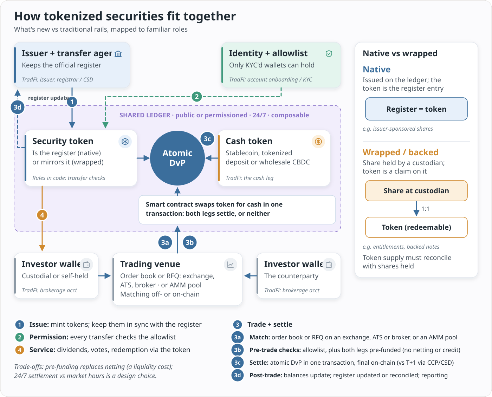

#  Ed's Tokenized Securities Rails

A tokenized security is a security whose ownership record lives on, or is mirrored to, a programmable shared ledger. That lets transfer rules, the cash leg and asset servicing run as code. What's new compared with today's rails:
- **The token is the register, or mirrors it.** Native tokens are the ownership record; wrapped tokens are claims on shares held by a custodian.
- **Permissioned transfer.** Only allowlisted, KYC'd wallets can hold the token.
- **Atomic DvP.** Orders match on a venue (order book, RFQ or AMM). After eligibility and pre-funding checks, a smart contract swaps the security token for a cash token (stablecoin, tokenized deposit or wholesale CBDC) in one transaction, instead of T+1 through a CCP and CSD.
- **24/7 and composable.** The trade-offs: pre-funding replaces netting, and operating hours become a design choice.

Read the full overview: [content/overview.md](content/overview.md) (on the site: `/overview`).

A human-curated, LLM-maintained, source-linked wiki on **tokenized securities infrastructure**: issuers, legal structures, custody, chains, venues, settlement and regulation. Every fact links to a source; unverified fields say `unknown`.

Site: https://edstokenizedsecuritiesrails.com · Machine-readable index: [`content/llms.txt`](content/llms.txt)

## How it works
`content/` is generated from a private source-of-truth vault by a publish script. Public pages carry headline fields and readable summaries; changes appear with a delay. Do not edit `content/` by hand.

Built with [Quartz v4](https://quartz.jzhao.xyz). Build: `npm ci && npx quartz build` (Node >= 22); output in `public/`.

## License
- Content (`content/`): [CC BY-NC 4.0](https://creativecommons.org/licenses/by-nc/4.0/) — see `LICENSE-CONTENT`.
- Code (Quartz and site config): MIT — see `LICENSE.txt`.

Reference information only. Not investment advice.
