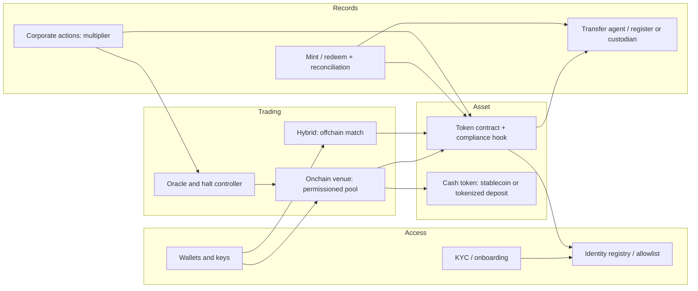
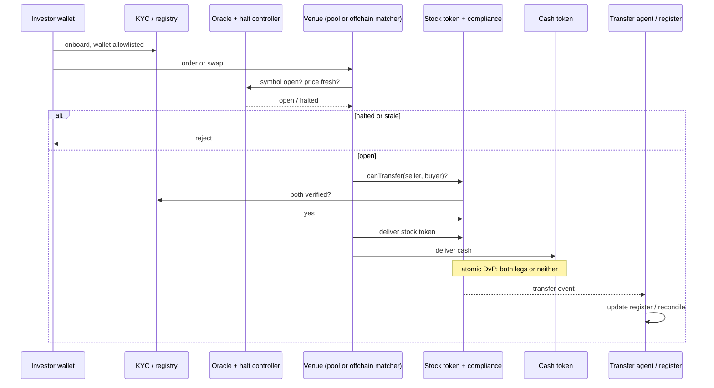

*In plain English: this page shows how all the parts of a tokenized-stock trading system fit together, from letting an investor in, through the trade, to updating the official record. Deeper pages on each part are planned.*

## End-to-end components

## One trade, end to end

On the **onchain path**, the pool prices and settles in one transaction (Uniswap v4 hooks check the allowlist on every swap ([Uniswap](https://developers.uniswap.org/docs/protocols/v4-hooks/permissioned-pools/architecture))). On the **hybrid path**, an offchain matcher agrees the trade and submits a settlement transaction. TSV LLC's notice describes atomic settlement on Canton with the issuer's transfer agent verifying participants and minting ([TSV LLC](https://www.tokenizedstockvenue.com/notice.html)).

## Components
| Component | What it does |
|---|---|
| Token contracts and compliance hooks | Enforce who can hold and receive; freeze, recover |
| Mint, redeem and reconciliation | Create and destroy supply against real shares |
| Onchain venue | Permissioned pool under the SEC exemption |
| Settlement | Atomic DvP against a cash token |
| Corporate actions | Multipliers, dividends, votes |
| Pricing and halts | Oracles; stop when the primary market stops |
| Wallets, custody and keys | Allowlisted wallets, custody, admin keys |
| Interoperability | Cross-chain supply; DTCC conversion |

## Key design decisions
- **Onchain vs hybrid matching.** A permissioned pool is what the SEC's Innovation Exemption covers for TSVs, with symbol and volume caps ([SEC order](https://www.sec.gov/files/rules/exorders/2026/34-106402.pdf)). Hybrid designs match offchain and settle onchain; Nasdaq's approved model keeps matching on its book and settlement at DTC ([SEC](https://www.sec.gov/files/rules/sro/nasdaq/2026/34-105047.pdf)).
- **Cash leg.** Stablecoins (OKXICE pairs USDC, USDG, USDT ([OKXICE](https://www.okx.com/cdn/assets/files/2610/798CC1267CB56FB2.pdf))) vs tokenized deposits or central bank money on a unified ledger ([BIS](https://www.bis.org/publ/arpdf/ar2025e3.htm)).
- **Native vs wrapper.** A native token is the share on the register; a wrapper is a claim on a custodied share and needs mint/redeem reconciliation ([[overview#native-vs-wrapped|native vs wrapper]]).
- **Chain choice.** Public chain (Uniswap on a public L1/L2) vs permissioned network (Canton, DTCC's Besu) ([DTCC](https://dtcclearning.com/documents/dtcc-digital-assets/digital-asset-solutions/tokenization-service/5699-dtcc-tokenization-service-product-tear-sheet-and-high-level-roadmap/file.html)).

## Rules that must always hold
1. Only eligible, allowlisted wallets ever receive the stock token ([ERC-3643](https://eips.ethereum.org/EIPS/eip-3643)).
2. Both legs of a trade settle or neither does.
3. No trading while the primary exchange has the stock halted (TSVs) ([SEC order](https://www.sec.gov/files/rules/exorders/2026/34-106402.pdf)).
4. Backed supply on all chains x multiplier never exceeds shares held.
5. The register (or custodian books) and chain state agree after every event.
6. Prices and multipliers used for trading are fresh and consistent ([Chainlink](https://docs.chain.link/data-feeds/tokenized-equity-feeds)).

Deeper pages on each component (token contracts and compliance hooks, mint and redeem, onchain venues, atomic settlement, corporate actions, pricing and halts, wallets and keys, interoperability) are planned.

> [!note] vs traditional trading infrastructure
> Traditional trading uses broker order routing, exchange order books or RFQ, CCP netting and T+1 settlement at DTC, with eligibility enforced by brokers and the transfer agent. Tokenized rails move eligibility into the token, settle atomically and run 24/7. See [[topics/settlement-and-matching|Settlement & matching]] and [[concepts/post-trade-reg-nms-model|Post-trade (Reg NMS) model]].

## Sources
Public originals for the facts on this page.

- <https://www.sec.gov/files/rules/exorders/2026/34-106402.pdf>
- <https://developers.uniswap.org/docs/protocols/v4-hooks/permissioned-pools/architecture>
- <https://www.tokenizedstockvenue.com/notice.html>
- <https://eips.ethereum.org/EIPS/eip-3643>
- <https://www.bis.org/publ/arpdf/ar2025e3.htm>
- <https://dtcclearning.com/documents/dtcc-digital-assets/digital-asset-solutions/tokenization-service/5699-dtcc-tokenization-service-product-tear-sheet-and-high-level-roadmap/file.html>
- <https://docs.chain.link/data-feeds/tokenized-equity-feeds>
- <https://www.sec.gov/files/rules/sro/nasdaq/2026/34-105047.pdf>
