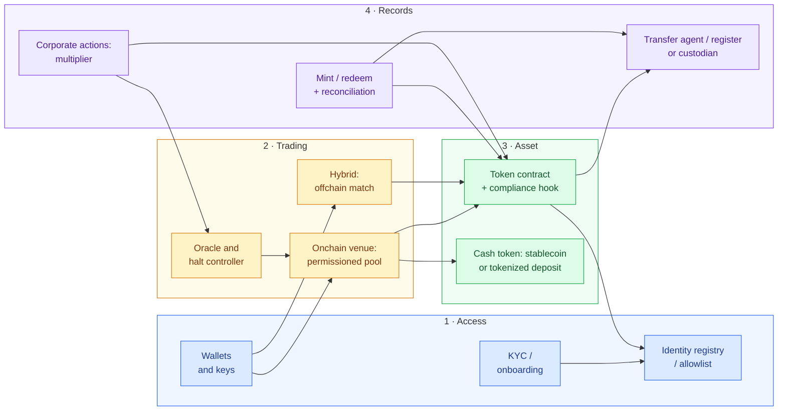
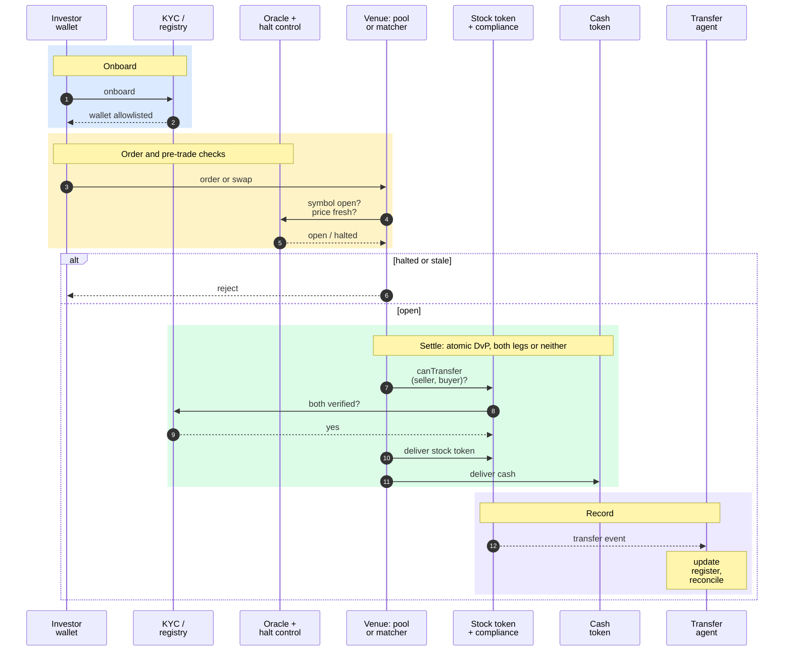
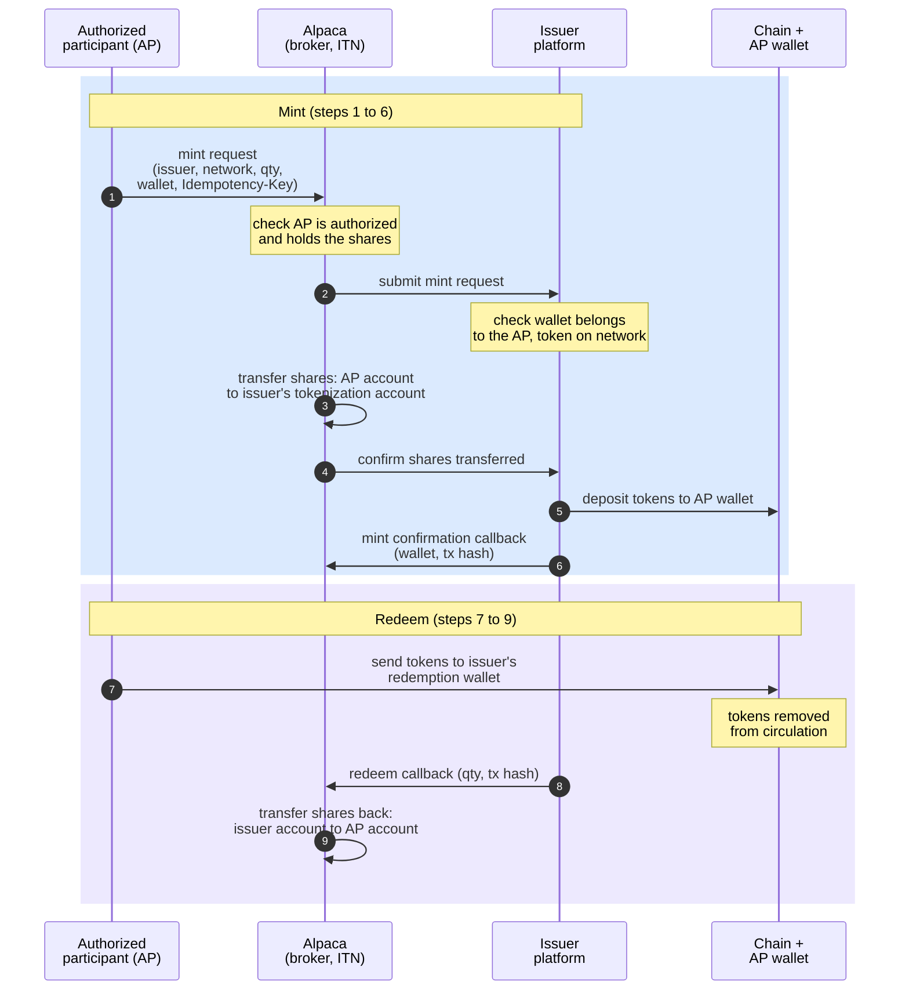
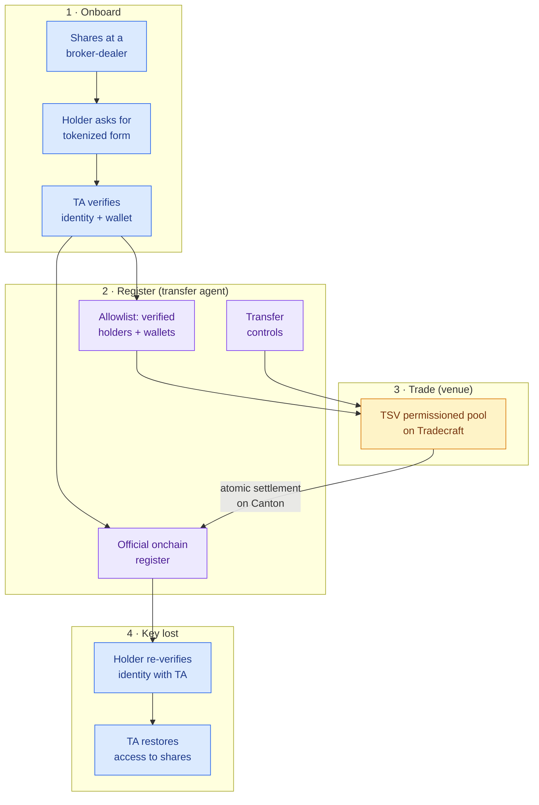
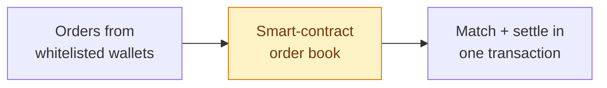
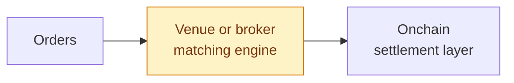
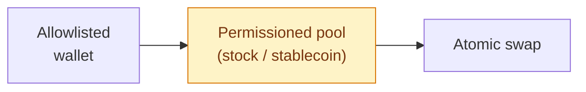
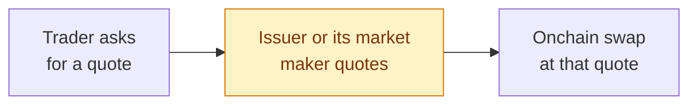
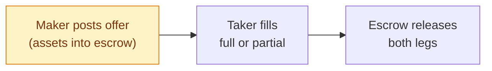
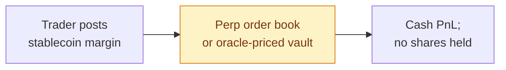

*In plain English: an overview of how a tokenized-stock trading system fits together, from letting an investor in, through the trade, to updating the official record. Deeper pages on each part will be added as the roadmap ships.*

*Illustrated overview: the shared ledger and one trade, end to end. The text diagrams below give the detail.*

## End-to-end components

Terms: [[concepts/glossary#kyc|KYC]] · [[concepts/glossary#allowlist|allowlist]] · [[concepts/glossary#wallet|wallets]] · [[concepts/glossary#admin-keys|keys]] · [[concepts/glossary#permissioned-pool|permissioned pool]] · [[concepts/glossary#hybrid-matching|hybrid matching]] · [[concepts/glossary#onchain--offchain|offchain]] · [[concepts/glossary#oracle|oracle]] · [[concepts/glossary#halt|halt]] · [[concepts/glossary#compliance-hook|compliance hook]] · [[concepts/glossary#stablecoin|stablecoin]] · [[concepts/glossary#tokenized-deposit|tokenized deposit]] · [[concepts/glossary#mint|mint]] · [[concepts/glossary#redeem|redeem]] · [[concepts/glossary#reconciliation|reconciliation]] · [[concepts/glossary#transfer-agent|transfer agent]] · [[concepts/glossary#custodian|custodian]] · [[concepts/glossary#corporate-action|corporate actions]] · [[concepts/glossary#multiplier|multiplier]]

Colors: **blue** = access, **amber** = trading, **green** = asset and cash, **purple** = records.

## One trade, end to end

Terms: [[concepts/glossary#dvp|DvP]] · [[concepts/glossary#atomic-settlement|atomic settlement]] · [[concepts/glossary#oracle|oracle]] · [[concepts/glossary#halt|halted]] · [[concepts/glossary#compliance-hook|compliance]] · [[concepts/glossary#transfer-agent|transfer agent]] · [[concepts/glossary#reconciliation|reconcile]]

Phases: **blue** = onboard, **amber** = order and checks, **green** = atomic settlement, **purple** = record. Same colors as the component map above.

## Components
| Component | What it does |
|---|---|
| Token contract + [[concepts/glossary#compliance-hook|compliance hook]] | Only eligible wallets can hold or receive (for example ERC-3643, or a Solana Token-2022 transfer hook) |
| [[concepts/glossary#mint|Mint]] / [[concepts/glossary#redeem|redeem]] + [[concepts/glossary#reconciliation|reconciliation]] | Supply matches real shares ([[#primary-market-mint-and-redeem-broker-custodied-model|how mint and redeem work]]) |
| Venue ([[concepts/glossary#permissioned-pool|permissioned pool]] or [[concepts/glossary#hybrid-matching|hybrid]]) | Matches and settles trades ([[#how-venues-match-and-settle|six designs]]) |
| [[concepts/glossary#oracle|Oracle]] + [[concepts/glossary#halt|halt]] control | Fresh prices; stop when the stock is halted. A permissioned AMM can instead price from the pool formula and use offchain market data only to pause trading |
| [[concepts/glossary#transfer-agent|Transfer agent]] / register | The official record stays in sync with the chain ([[#issuer-sponsored-register-permissions-and-recovery|issuer-sponsored register]]) |

## Key rules
1. Only allowlisted wallets ever receive the stock token ([ERC-3643](https://eips.ethereum.org/EIPS/eip-3643)).
2. Both legs of a trade settle or neither does ([[concepts/glossary#atomic-settlement|atomic settlement]]).
3. No trading while the primary exchange has the stock halted ([SEC order](https://www.sec.gov/files/rules/exorders/2026/34-106402.pdf)).

> [!note] vs traditional trading infrastructure
> Traditional trading uses broker order routing, exchange order books or RFQ, CCP netting and T+1 settlement at DTC, with eligibility enforced by brokers and the transfer agent. Tokenized rails move eligibility into the token, settle atomically and run 24/7. See [[topics/settlement-and-matching|Settlement & matching]] and [[concepts/post-trade-reg-nms-model|Post-trade (Reg NMS) model]].

## Primary market: mint and redeem (broker-custodied model)
*In plain English: before a backed stock token can trade, a large firm has to swap real shares for new tokens. This is how that swap works on Alpaca's Instant Tokenization Network (ITN), the broker-side system several issuers plug into.*

Who does what: the [[concepts/glossary#authorized-participant|authorized participant]] (AP) holds shares in its own Alpaca account; Alpaca moves the shares; the issuer checks the wallet, mints and burns the tokens. The ITN mint API accepts these issuer values: binance, coinbase, ondo, st0x and xstocks ([Alpaca mint API](https://docs.alpaca.markets/us/reference/posttokenizationmintbroker)).

Terms: [[concepts/glossary#authorized-participant|authorized participant]] · [[concepts/glossary#mint|mint]] · [[concepts/glossary#redeem|redeem]] · [[concepts/glossary#wallet|wallet]] · [[concepts/glossary#custodian|custodian]]

- **Mint:** the AP calls `POST /v1/accounts/{account_id}/tokenization/mint`. Alpaca checks the AP is authorized and has the position; the issuer checks the wallet is registered to the AP and the token exists on that network. Alpaca then moves the shares from the AP's account to the issuer's designated Alpaca account and confirms; the issuer deposits the tokens and calls back ([AP guide](https://docs.alpaca.markets/us/docs/tokenization-guide-for-authorized-participant); [issuer guide](https://docs.alpaca.markets/us/docs/tokenization-guide-for-issuer)).
- **Redeem:** the AP sends tokens to the issuer's redemption wallet, the issuer removes them from circulation and calls Alpaca's redeem endpoint, and Alpaca moves the shares back ([issuer guide](https://docs.alpaca.markets/us/docs/tokenization-guide-for-issuer); [redeem API](https://docs.alpaca.markets/us/reference/posttokenizationredeem)).
- **Retries without double mints:** the AP can send an optional `Idempotency-Key`; the same key with the same body replays the first response, a different body gets a 422 ([mint API](https://docs.alpaca.markets/us/reference/posttokenizationmintbroker)). Issuers must treat Alpaca's `tokenization_request_id` as an idempotency key so a repeated delivery mints at most once ([issuer guide](https://docs.alpaca.markets/us/docs/tokenization-guide-for-issuer)).
- **Precision:** underlying quantities are capped at 9 decimal places for both mint and redeem ([issuer guide](https://docs.alpaca.markets/us/docs/tokenization-guide-for-issuer)).
- **What this model means:** the shares stay at a broker; the token is backed by that broker position, not recorded on the company's register. Compare the issuer-sponsored register below.
- **Shared custodian dependency.** Several issuers plug into the same broker-side ITN. In this model the shares stay in a broker account, so a problem at that broker or in that account structure is a shared dependency for those products, which is different from an issuer-sponsored register. Alpaca is named here because it operates the ITN described above; it is not automatically the custodian of every token on this wiki (see [[topics/custody#who-holds-the-shares-behind-most-tokens|Who holds the shares behind most tokens]]). The ITN mint API's issuer values include binance, coinbase, ondo, st0x and xstocks, which shows those names are set up as ITN issuers, not which firm holds every backing share ([Alpaca mint API](https://docs.alpaca.markets/us/reference/posttokenizationmintbroker)).
- **In-kind share conversion (Ondo, institutional).** Ondo's 12 Nov 2026 blog says it has introduced in-kind conversion between Ondo Stocks and underlying shares through Alpaca's ITN, alongside cash-funded minting: approved institutions will be able to transfer existing shares from their Alpaca account and receive corresponding Ondo Stocks, and redemptions on that route return shares rather than cash ([Ondo](https://ondo.finance/blog/ondo-stocks-as-collateral-on-spout)). That is Ondo's description of an institutional primary-market route; direct mint and redeem on the Ondo platform remain USDon or USDC. The same post describes Spout as planning, when it launches on Solana, to redeem Ondo Stocks in kind into Spout's Alpaca brokerage account, sell weekly covered calls on the shares, and reconcile brokerage and onchain records before each options cycle. Spout's launch and lending terms are planned, as described by Ondo, not live.
- **Planned prime brokerage (Alpaca's description).** In a 15 Oct 2026 interview on NYSE Live, Alpaca's co-founder and CEO, Yoshi Yokokawa — not an NYSE official — said the firm planned to launch a prime brokerage business "next year." The host used that wording; given the interview date, that would be 2027. His reasoning was that tokenization is still early, that it needs liquidity, that liquidity needs market makers, and that market makers need prime-brokerage services such as financing, margin, and multiple asset classes. This is a plan described in the interview, not a launch, and the wording is from auto-generated captions ([NYSE Live](https://www.youtube.com/watch?v=c8VAgn88uqs)).

## Issuer-sponsored register: permissions and recovery
*In plain English: in the issuer-sponsored model, the company's own transfer agent writes the token holder onto the official shareholder list. Worked example: Canton Strategic Holdings (CNTN) with [[infrastructure/fairmint|Fairmint]] as transfer agent, first traded on 4 Nov 2026.*

Terms: [[concepts/glossary#transfer-agent|transfer agent]] · [[concepts/glossary#issuer-sponsored-token|issuer-sponsored token]] · [[concepts/glossary#allowlist|allowlist]] · [[concepts/glossary#permissioned-pool|permissioned pool]] · [[concepts/glossary#atomic-settlement|atomic settlement]] · [[concepts/glossary#canton|Canton]]

1. **Onboarding:** the seller, an existing shareholder, asked for its CNTN shares in tokenized form. Fairmint, for the company, recorded them directly with the holder's verified wallet, "moving its position from a broker-dealer account onto the Company's onchain shareholder register" ([CNTN release](https://www.prnewswire.com/news-releases/first-trades-of-tokenized-us-equity-under-sec-innovation-exemption-executed-on-the-canton-network-302929795.html)).
2. **Register and allowlist:** Fairmint keeps the official onchain ownership record, operates the allow list of verified holders and wallets, and applies the company's transfer controls. Only holders Fairmint has verified and approved can hold or trade ([CNTN release](https://www.prnewswire.com/news-releases/first-trades-of-tokenized-us-equity-under-sec-innovation-exemption-executed-on-the-canton-network-302929795.html)).
3. **Trade:** the venue is separate. TSV LLC runs a permissioned pool on the Tradecraft AMM; on 4 Nov the buyer bought from the seller with a liquidity provider in the pool, settled atomically on Canton. Size and price were not disclosed ([CNTN release](https://www.prnewswire.com/news-releases/first-trades-of-tokenized-us-equity-under-sec-innovation-exemption-executed-on-the-canton-network-302929795.html)). Details: [[platforms-venues/tsv-llc|TSV LLC]].
4. **Transfer-agent powers:** in its SEC letter, Fairmint lists what a recordkeeping transfer agent must be able to do to the master record: record entries, correct entries, freeze positions or place stops, reverse or cancel entries, and produce a true copy ([Fairmint letter](https://www.sec.gov/comments/S7-2026-30/s7202630-1120639-3987647.pdf), its proposed definition of "exclusive control").
5. **Lost key:** "Lose it, and the transfer agent can verify it's you & restore your shares," per Fairmint's CEO ([Joris Delanoue on X](https://x.com/Joris_DLN/status/2116483159587992022), attributed). Fairmint's letter makes the same point: "A lost or compromised key should not change who owns the security" ([Fairmint letter](https://www.sec.gov/comments/S7-2026-30/s7202630-1120639-3987647.pdf)).

An onchain official register like this one is possible today; CNTN runs on one. What the SEC's transfer agent proposal adds as a proposed baseline is a holder name and mailing address requirement, which Coinbase opposes ([Coinbase letter](https://www.sec.gov/comments/S7-2026-30/s7202630-1119719-3983946.pdf)). See [[#holder-rights-and-compliance-controls|Holder rights and compliance controls]].

### Broker-backed vs issuer-sponsored register
| | Broker-backed (Alpaca ITN) | Issuer-sponsored register (Fairmint / CNTN) |
|---|---|---|
| Where the share sits | Issuer's designated account at Alpaca ([issuer guide](https://docs.alpaca.markets/us/docs/tokenization-guide-for-issuer)) | On the company's official register, kept onchain by its transfer agent ([CNTN release](https://www.prnewswire.com/news-releases/first-trades-of-tokenized-us-equity-under-sec-innovation-exemption-executed-on-the-canton-network-302929795.html)) |
| What the token is | A token the issuer mints against shares moved into its account | The registered share in token form, per the company |
| Who creates supply | APs, through the 6-step mint | The transfer agent, recording a holder's shares in tokenized form |
| Eligibility check | Alpaca checks the AP; issuer checks the AP's wallet | Transfer agent verifies every holder and wallet before they can hold or trade |
| Reconciliation | Token supply against shares in the issuer's Alpaca account | The register is the record; no separate mirror, per Fairmint ([Fairmint](https://www.fairmint.com/blog/what-issuer-sponsored-tokenized-stock-looks-like-cntn-selects-fairmint/)) |
| Lost key | Depends on the issuer's token terms | Transfer agent can re-verify and restore, per Fairmint (attributed) |
| Examples | Issuer values in the ITN API: binance, coinbase, ondo, st0x, xstocks | CNTN on TSV LLC |

Neither column says anything about DTC or brokers elsewhere in the chain; an onchain register does not by itself show that no broker or DTC role exists. Legal models across all implementations: [[comparisons/implementations-by-model|Implementations by model]].

### Securitize entitlement tokens with self-custodial wallets (OKXICE)
*In plain English: on this venue the token is described as a claim on a real share, held in the customer's own wallet after the customer has been checked and onboarded. This is how OKX describes the OKXICE design, not a legal conclusion.*

On 23 Nov 2026 OKX said [[platforms-venues/okxice-tsv|OKXICE TSV]] opened at noon ET that day for eligible U.S. customers, in the TSV tab of the OKX app. [[issuers/securitize|Securitize]] provides the tokenization infrastructure. Each token is a security entitlement backed one-to-one by an underlying share, with applicable shareholder rights and economic benefits, including dividends, voting rights and corporate actions. Customers hold the tokens in self-custodial wallets; the venue does not hold customer assets or private keys. Access is limited to eligible U.S.-based OKX Inc. customers who complete identity verification, activate a CeDeFi Wallet and complete OKX Inc. onboarding, and is subject to geographic and other eligibility requirements. The venue's smart contracts restrict trading and liquidity provision to eligible wallets ([OKX](https://www.okx.com/en-us/learn/okxice-tsv-launch-going-live)).

The 20 Nov 2026 TSV notice names Securitize Markets, LLC as the tokenizer for the six Tokenized NMS Stocks made available at launch (COIN, SECZ, MSTR, BTGO, HOOD and CRCL), each paired with USDC. It describes the same third-party model: each token represents a security entitlement to one share of the underlying NMS stock; ownership is recorded on the chain and reconciled with the tokenizer's books and records; mint and redemption run through the tokenizer acting through its broker-dealer ([OKXICE notice, 20 Nov](https://www.okx.com/cdn/assets/okfe/web3-activities/okxicetsv/notices/OKXICE_Tokenized_Securities_Venue_Public_Notice_26.11.20.pdf)). This subsection records that pattern as those sources describe it. It is reference information, not legal advice, and it does not treat this as the only way to structure an entitlement token. It is also distinct from [[issuers/securitize|Securitize Stocks]] on Solana, which is a separate product.

### Proposed by Fairmint, not current law or production
**Proposed by Fairmint (SEC comment letter, Nov 3 2026), not current law or production.** In its letter on the SEC's transfer agent rules (File S7-2026-30), Fairmint proposes ([Fairmint letter](https://www.sec.gov/comments/S7-2026-30/s7202630-1120639-3987647.pdf)):
- **One record, many venues:** one accountable recordkeeping transfer agent per issue, with co-transfer agents keeping the detailed record for a form of holding (such as tokenized positions) at each venue under a written agreement.
- **Reconciliation:** co-transfer agents report debits and credits to the master file within one business day and reconcile at least daily.
- **DvP registration:** a transfer is registered once payment settles elsewhere, so delivery and payment happen together; the agent need not hold the funds.
- **Cash leg:** stablecoins and tokenized deposits held in bank custodial wallets could count as funds on a functional test.
- **"Exclusive control" by function:** sole authority to record, correct, freeze, reverse and produce the record, whatever technology holds it.
- **Keys:** possession of a key is not by itself authority to transfer; recovery from lost or compromised credentials must be tested.
- **Identifiers:** shares in token form keep the class's CUSIP, with the token contract address recorded as position detail.

Comment letters are advocacy, not rules. For the developer side, Fairmint's Open Cap Table Protocol has a Canton SDK quickstart that creates and reads a cap table on a local sandbox ([OCP quickstart](https://opencaptableprotocol.org/sdk/canton/quickstart/)); it is register tooling, not a trading API, and its licence (Apache-2.0 on GitHub as of 9 Nov 2026) should be checked before reuse.

## How venues match and settle
*In plain English: "trading onchain" can mean six quite different machines. Each design below shows where buyers and sellers meet and how the trade settles.*

Side-by-side table with 16 venues: [[comparisons/trading-venue-architectures|Trading venue architectures]].

**1. Onchain order book** ([[platforms-venues/21x|21X]])

Order entry, matching and settlement all run onchain against a stablecoin, with whitelisted wallets and a circuit breaker ([21X](https://21x.eu/smart-contracts-and-the-role-of-regulated-market-infrastructures/)). Can it scale? 21X and LayerZero report 10,000 matches per second in a month-long pilot on a private Zero instance (**company-reported**, [21X](https://21x.eu/21x-ag-and-layerzero-deliver-institutional-grade-onchain-trading-pilot-on-private-permissioned-deployment-of-zero/)).

**2. Offchain match, onchain settle** ([[platforms-venues/seturion|Seturion]], [[issuers/dinari|Dinari]], [[platforms-venues/nyse-ice-tokenized-platform|NYSE]] planned)

Existing EU venues keep their matching and settle tokenized trades on Seturion, against central bank money or onchain cash, without their own DLT licence ([Seturion](https://group.boerse-stuttgart.com/en/seturion/)). Dinari runs an order book on its own Avalanche L1, the Dinari Financial Network, with validators including Gemini, BitGo and VanEck ([Dinari](https://dinari.com/blog/dinari-launches-the-dinari-financial-network-an-omni-chain-orderbook-powered-by-avalanche)).

*Split layers, NYSE's planned platform (announced 9 Nov 2026, subject to regulatory approval):*
- **Matching:** NYSE's existing technology, the Pillar trading engine. Michael Blaugrund of the New York Stock Exchange described Pillar as processing "millions of messages per second, with tens of microseconds in latency," and said post-trade systems still run on mainframes ([Avalanche Originals](https://www.avalanche.com/originals/the-invisible-layer-of-global-financial-infrastructure/)). Earlier news reports had already named Pillar as the matching engine ([The Block](https://www.theblock.co/news/business/2026-11-09-nyse-settle-tokenized-stocks-avalanche-planned-24-7-market-436208), citing The Wall Street Journal; [CoinDesk](https://www.coindesk.com/business/2026/11/09/nyse-picks-avalanche-to-settle-tokenized-stocks-amid-wall-street-s-blockchain-race)).
- **Clearing and settlement ledger:** Avalanche provides "the core ledger technology for the clearing firm" ([NYSE on X](https://x.com/NYSE/status/2119812983224213903); [Ava Labs](https://www.avalanche.com/about/blog/wall-streets-next-chapter-is-being-built-on-avalanche)). Ava Labs has separately described that ledger as a dedicated Avalanche layer-1 (formerly a subnet); NYSE and ICE have not said that in their own materials ([Paul Barron interview with John Nahas](https://www.paulbarronnetwork.com/network-update/nyse-chooses-avalanche-for-tokenized-equities-interview-ava-labs-john-nahas); [Avalanche NYSE page](https://www.avalanche.com/nyse/)).
- **Issuance:** stocks may be issued on a range of blockchains, not only the settlement ledger (news reports: [The Block](https://www.theblock.co/news/business/2026-11-09-nyse-settle-tokenized-stocks-avalanche-planned-24-7-market-436208); [CoinDesk](https://www.coindesk.com/business/2026/11/09/nyse-picks-avalanche-to-settle-tokenized-stocks-amid-wall-street-s-blockchain-race)).

Each layer can then use a different technology; NYSE's Dennis Lee said the exchange is "picking the right technology for each job" ([CoinDesk](https://www.coindesk.com/business/2026/11/09/nyse-picks-avalanche-to-settle-tokenized-stocks-amid-wall-street-s-blockchain-race)).

**3. Permissioned AMM pool** ([[platforms-venues/okxice-tsv|OKXICE TSV]], [[platforms-venues/tsv-llc|TSV LLC]], [[platforms-venues/formation-securities|Formation Securities]])

Each trade executes against the pool in one transaction, so there is no order priority among participants on OKXICE ([OKXICE notice, 20 Nov](https://www.okx.com/cdn/assets/okfe/web3-activities/okxicetsv/notices/OKXICE_Tokenized_Securities_Venue_Public_Notice_26.11.20.pdf)). The 20 Nov notice lists the XLayer contracts that make up that design: TSVRegistryV1, TSVSwapRouterV1, TSVVolumeLedgerV1, TSVLPManagerV1, TSVHookV1 (the OKXICE TSV Hook), PermissionsAdapterFactory, an SBT contract, and Uniswap v4's PoolManager, which the notice describes as third-party contracts that do not belong to OKXICE TSV. A wallet holding a valid soulbound token may call the TSV contracts directly; the notice says the venue does not currently support aggregators, solvers or relayers. Prior to commencing operations, the contracts were audited internally by OKX Technology Inc. and externally by Certified Kernel Tech LLC ([OKXICE notice, 20 Nov](https://www.okx.com/cdn/assets/okfe/web3-activities/okxicetsv/notices/OKXICE_Tokenized_Securities_Venue_Public_Notice_26.11.20.pdf)). On 23 Nov 2026 OKX said [[platforms-venues/okxice-tsv|OKXICE TSV]] opened at noon ET that day ([OKX](https://www.okx.com/en-us/learn/okxice-tsv-launch-going-live)). TSV LLC runs CNTN in a permissioned pool on Tradecraft ([CNTN release](https://www.prnewswire.com/news-releases/first-trades-of-tokenized-us-equity-under-sec-innovation-exemption-executed-on-the-canton-network-302929795.html)). [[platforms-venues/formation-securities|Formation Securities]]'s 9 Nov 2026 TSV notice describes permissioned concentrated-liquidity AMM pools on Solana using licensed Orca AMM contracts, plus a licensed offchain Formation Router that selects routes and is expected to refresh quotes after about 15 seconds. Pool prices come from the concentrated-liquidity formula; the notice says the TSV's smart contracts do not use pricing oracles or other external pricing market data. Halt, suspension, Limit Up-Limit Down and volume-cap data come from a third-party market-data vendor and trigger an onchain pause, which does not require a multi-signature transaction. During a stoppage, no trades execute and liquidity providers may withdraw liquidity but may not deposit or reposition it ([Formation notice](https://www.formationsecurities.com/notice.pdf)). On 5 Nov 2026 Groma opened a permissioned GRO/USDC pool on Base through Uniswap's permissioned-pool infrastructure, for a real-estate trust token rather than a listed stock ([Groma](https://groma.substack.com/p/bringing-real-estate-to-uniswap-introducing)); see [[infrastructure/uniswap-permissioned-pools|Uniswap v4 permissioned pools]].

**4. Issuer RFQ** (JTX routing to [[issuers/ondo-global-markets|Ondo]], [[issuers/backpack|Backpack]], [[issuers/xstocks-backed|xStocks]])

Jito Labs' JTX terminal offers request-for-quote swaps of up to \$1M from Solana issuers such as Backpack, xStocks and Ondo ([SolanaFloor](https://solanafloor.com/news/jtx-equities-discoverability-rfq-execution-1650-tokenized-stocks), a Jito Network outlet). Quotes are only as available as the issuer's own hours: Ondo Stocks follow the four US sessions (overnight via the Blue Ocean ATS), plus an Off-Hours session for selected assets, and halt during corporate actions ([Ondo docs](https://docs.ondo.finance/ondo-stocks/market-hours-and-trading-availability)).

**5. P2P escrow (OTC)** (Swarm)

Swarm's open dOTC contracts hold the maker's assets in escrow until a taker fills the offer; offers can set price, size, a settlement window and counterparty restrictions ([GitHub](https://github.com/SwarmMarkets/open-dotc)).

**6. Perps engine** ([[platforms-venues/hyperliquid-equity-perps|Hyperliquid HIP-3, Ostium]])

On HIP-3 the market's deployer runs the oracle and HyperCore runs matching, margin and liquidation ([Hyperliquid docs](https://hyperliquid.gitbook.io/hyperliquid-docs/hyperliquid-improvement-proposals-hips/hip-3-builder-deployed-perpetuals)); Ostium prices from its own consensus oracle and hedges flow offchain ([Ostium docs](https://docs.ostium.com/protocol/how-ostium-works)).

| Design | Latency | Who holds the share | Allowlist | Off-hours price | Settlement asset |
|---|---|---|---|---|---|
| Onchain order book | Bound by chain throughput | Depends on the token | Whitelisted wallets | Order book (no oracle needed) | Stablecoin |
| Offchain match, onchain settle | Venue engine speed | Depends on the token | At the venue/broker | Venue | Central bank money, fiat or onchain cash |
| Permissioned AMM pool | One transaction | Depends on the token | Pool allowlist | Pool price | Stablecoin |
| Issuer RFQ | Quote round-trip | Issuer's model | Issuer's rules | Issuer's sessions | Varies |
| P2P escrow | Until a taker fills | Depends on the token | Offer-level | Counterparties | Asset named in the offer |
| Perps engine | Order book or oracle update | No share at all | Venue rules | Oracle | Stablecoin margin (USDC on Ostium; deployer's quote asset on HIP-3) |

Off-hours demand, attributed: Ondo said its tokenized stocks traded "about 10x its usual volume after the closing bell" on US election night ([Ondo on X](https://x.com/Ondo/status/2118090005071396987), company-reported); for perps, see [[platforms-venues/hyperliquid-equity-perps|Equity perps]].

## Off-hours pricing and collateral
*In plain English: when the cash stock market is closed, a token can still trade, but the official price feed may be stale, paused, or using a different method, and loans against the token can still be liquidated.*

- **Market-status flags, not timestamps.** For traditional-market assets, Chainlink Data Streams tell developers to use the `marketStatus` flag in price reports, not the report's last-seen or observation timestamp, to decide whether the market is open. The flag is referential only. On 24/5 US Equities streams, `marketStatus` 5 means Closed (weekends, holidays, or unexpected closures; about 8:00pm Friday–8:00pm Sunday ET). 24/7 streams may keep publishing while that flag is 5, switching to an off-hours price derived from perpetual futures ([Chainlink Data Streams](https://docs.chain.link/data-streams/rwa-streams/24-5-us-equities-user-guide)).
- **Staleness checks.** When a 24/5 feed stops updating, `updatedAt` stops advancing while the contract may still be callable. Coinbase tokenized-equity feeds on Base hold the last close on weekends and holidays and freeze during corporate actions; the Base docs say to apply staleness bounds and never settle or liquidate against a frozen feed ([Base docs](https://docs.base.org/build-on-base/integrate-defi/list-tokenized-stocks)).
- **Issuer oracle pauses.** A Coinbase onchain oracle registry exposes a pause flag. When paused, the feed stops publishing and holds the last known good value; mint and redeem can also be paused offchain during a corporate action without pausing the token onchain, so transfers are not blocked while the feed is frozen ([Base docs](https://docs.base.org/build-on-base/integrate-defi/list-tokenized-stocks)).
- **Liquidation while the underlying is closed.** A lending market can still liquidate collateral when the cash equity market is shut. That risk is already recorded for Kamino's isolated Backpack Market ([Business Wire](https://www.businesswire.com/news/home/20261104930970/en/Kamino-and-Backpack-Securities-Expand-Credit-for-Tokenized-U.S.-Equities), 4 Nov 2026). Off-hours issuer quotes can also diverge from the next reopen value, as Ondo documents for its Off-Hours session ([Ondo docs](https://docs.ondo.finance/ondo-stocks/market-hours-and-trading-availability)). See [[topics/settlement-and-matching#what-prices-a-stock-token-when-the-market-is-closed|What prices a stock token when the market is closed?]].
- **Aave Equities Hub (24/5 hold).** On [[platforms-venues/aave|Aave]] V4's Equities Hub on Base, some [[issuers/coinbase-tokenized-stocks|Coinbase]] stock tokens can be posted as collateral to borrow USDC. Aave says Chainlink 24/5 feeds hold the last published price over weekends and U.S. holidays, and that during that window a position's health factor can fall only through interest accrual; a gap at the reopen can therefore move collateral value in one step ([Aave](https://aave.com/blog/coinbase-tokenized-stocks)). LlamaRisk's 23 Nov 2026 collateral-factor proposal (not stated as executed) sizes those factors for a 24/5 off-hours fall into the next regular open ([ARFC](https://governance.aave.com/t/arfc-collateral-factor-update-for-coinbase-tokenized-equities-on-base/26482)). The 21 Sep 2026 update to the deployment ARFC said 24/7 feeds were expected later; whether they are in production is not stated in the sources reviewed on 23 Nov 2026 ([ARFC, Deploy Aave V4 on Base](https://governance.aave.com/t/arfc-deploy-aave-v4-on-base/25427)).
- **Issuer Off-Hours mint and redeem (dated snapshot).** Ondo's Off-Hours docs, retrieved 16 Nov 2026, say a dedicated Off-Hours session runs when conventional sessions are closed — weekends, holidays and early-close days — on Ethereum, BNB Chain and Solana. Buys and sells are still quoted, minted and redeemed instantly. The page then listed 32 enabled assets (including AAPLon, NVDAon, TSLAon, SPYon, QQQon, IBITon and SPCXon). Each asset has its own dynamic Off-Hours limit, separate from regular-session limits; quotes can be declined at the limit, and spreads may be wider. The list and limits can change; current status is at status.ondo.finance/market ([Ondo Off-Hours](https://docs.ondo.finance/ondo-stocks/off-hours-trading)). See [[issuers/ondo-global-markets|Ondo Stocks]].
- **Reporting and data used for TSV controls.** Chainlink Labs' 11 Nov 2026 comment letter proposes voluntary conventions so TSV trade reports can be compared across venues (stable identifiers, stated USD conversion methods, linked corrections, and a free open API), and nonbinding principles for assessing external data used in pricing and controls. Chainlink is a vendor of these services; the letter is advocacy, not a requirement ([Chainlink Labs](https://www.sec.gov/comments/4-927/4927-1133160-4036827.pdf)).
- **Fund example: pre-funded off-hours inventory.** A 12 Nov 2026 Securitize and Ethena Labs release describes a 24/7 liquidity facility for BlackRock's BUIDL that lets eligible investors exchange BUIDL for supported stablecoins, including USDC, and back, outside traditional market hours. It launches with \$50 million of initial liquidity (\$25 million USDC and \$25 million BUIDL), and says up to another \$50 million may be made available within about an hour, for a maximum capacity of \$100 million — not an amount continuously funded or immediately available ([Securitize](https://investors.securitize.io/news/news-details/2026/Securitize-and-Ethena-Launch-100-Million-Liquidity-Facility-for-BlackRocks-BUIDL/default.aspx)). This is a tokenized fund, not a stock token.

## Chains and bridges
*In plain English: some tokens can move between networks. The check that a transfer is valid can sit with a required verifier in a quorum, not only with the issuer's own systems.*

On 10 Nov 2026 [[issuers/ondo-global-markets|Ondo]] said the Fidelity Center for Applied Technology (FCAT) is now a required verifier for Ondo Stocks transfers via the Ondo Bridge, with FCAT's LayerZero DVN participating alongside a quorum of verifiers: 35 Ondo Stocks to HyperEVM and all 450+ Ondo Stocks on other supported chains, in Ondo's wording (the vault records 452 tokenized stocks and ETFs on Ondo's registry as of 10 Nov 2026). Cross-chain transfers are for eligible investors outside the United States ([Ondo blog, 10 Nov 2026](https://ondo.finance/blog/ondo-bridge-adds-fcat-as-required-verifier)).

Native issuance is a different design from a bridged or wrapped deployment. A 12 Nov 2026 Optimism Foundation blog, a joint announcement with xStocks and ether.fi, says [[issuers/xstocks-backed|xStocks]]' full catalog of 1,500+ tokenized equities has been natively minted and redeemed on OP Mainnet for several months, with no OFT bridge in the path, and that ether.fi's native mint and redeem went live in-app that day after a wrapped summer 2026 offering ([Optimism](https://optimism.io/blog/xstocks-native-op-mainnet-ether-fi-launch)). Quote that 1,500+ catalog count with its 12 Nov 2026 date; other xStocks catalog figures from nearby dates are recorded on the issuer page.

[[infrastructure/dtcc-tokenization-pilot|DTCC]] said on 12 Nov 2026 that it plans to connect the DTCC Tokenization Service to Solana's L1, with DTC-tokenized assets expected on Solana in the second half of 2027, to support conversion of eligible DTC-custodied assets into tokenized form and related token lifecycle functionality ([DTCC](https://www.dtcc.com/press-releases/2026/dtcc-tokenization-service-to-connect-with-solana)).

## Holder rights and compliance controls
*In plain English: who can vote, who can hold, and which record counts, by model. Only working mechanisms and clearly labeled proposals.*

**Voting, by model**
| Model | Voting path | Status |
|---|---|---|
| Custodial token (Dinari dShares) | Eligible holders vote through Broadridge's proxy process; votes count in the formal shareholder vote ([Broadridge](https://www.broadridge.com/press-release/2026/broadridge-brings-proxy-voting-to-dinaris-dshares-tokenized-us-equities)) | Announced 5 Nov 2026; wallet login and direct onchain ballots are future steps |
| Issuer-sponsored (NYSE platform) | Broadridge governance smart contracts; holders vote via wallets, broker apps or ProxyVote ([Broadridge](https://www.broadridge-ir.com/news/news-details/2026/Broadridge-to-Bring-OnChain-Governance-and-Digital-Transfer-Agency-to-New-York-Stock-Exchange-Tokenized-Securities-Platform/default.aspx)) | Planned; NYSE platform awaits approval |
| Issuer-sponsored (CNTN) | Same rights as Nasdaq holders, per the company ([CNTN release](https://www.prnewswire.com/news-releases/first-trades-of-tokenized-us-equity-under-sec-innovation-exemption-executed-on-the-canton-network-302929795.html)) | Issuer claim; mechanism not described |
| Synthetic / perps | None | No share behind the position |

Broadridge calls its onchain proxy voting the first US platform to support all tokenization models (Broadridge's claim). See [[infrastructure/broadridge|Broadridge]] and [[issuers/dinari|Dinari]].

**Allowlists and transfer approvals**
- **DA Registry (Canton):** issuance controls such as allowlists, blocklists and transfer approvals connected to external KYC and AML providers ([Digital Asset](https://blog.digitalasset.com/press-release/openassets-and-digital-asset-partner)). Digital Asset says DA Registry has enabled "more than 30 issuers and tokenization platforms" (company claim).
- **OKXICE TSV:** OKXICE's operational team adds and removes wallets on the permissioning list and can pause pools, using pre-set conditions and a single-signature administrative key; upgrades, new pools and liquidity withdrawals need a multi-signature transaction ([OKXICE notice, 5 Nov](https://www.okx.com/cdn/assets/okfe/web3-activities/okxicetsv/notices/OKXICE_Tokenized_Securities_Venue_Public_Notice_26.11.05.pdf)).
- **Fairmint (CNTN):** the transfer agent runs the allow list of verified holders and wallets ([CNTN release](https://www.prnewswire.com/news-releases/first-trades-of-tokenized-us-equity-under-sec-innovation-exemption-executed-on-the-canton-network-302929795.html)).
- **Solana Token-2022 transfer hook ([[platforms-venues/formation-securities|Formation Securities]]):** the TSV's 9 Nov 2026 notice says wallet and transfer restrictions are enforced with Solana Token Extensions (Token-2022) transfer hooks, and that the hook does not change the AMM pricing formula, tick structure or trade quantity ([Formation notice](https://www.formationsecurities.com/notice.pdf)).

**Which record counts: competing asks to the SEC (advocacy, not law)**
The SEC proposed amendments to its transfer agent rules in September 2026 (Release 34-106246, File S7-2026-30). Comment letters pull in different directions:
- **Nasdaq (5 Nov):** interoperability between onchain and offchain master securityholder files and the national clearance and settlement system, and fungibility at the recordkeeping layer, consistent with the trading-layer fungibility in its own tokenization plans ([Nasdaq letter](https://www.sec.gov/comments/S7-2026-30/s7202630-1122619-3995826.pdf)).
- **Coinbase (3 Nov):** a blockchain record can itself be the master securityholder file; holders can be identified by wallet address without a mandatory name and mailing address; "exclusive control" should not require reversal keys or approved-wallet limits ([Coinbase letter](https://www.sec.gov/comments/S7-2026-30/s7202630-1119719-3983946.pdf)).
- **Fairmint (3 Nov):** one recordkeeping agent with co-transfer agents per venue, and a functional definition of exclusive control that keeps record, correct, freeze and reverse powers with the agent ([Fairmint letter](https://www.sec.gov/comments/S7-2026-30/s7202630-1120639-3987647.pdf)). Proposed by Fairmint, not current law.
- **Metrika (3 Nov):** for a master securityholder file on a public chain the transfer agent does not control, treat network risk as a material risk under Rule 17ad-12 with real-time monitoring; treat exclusive control as covering the token's privileged functions (issue, cancel, freeze, force-transfer) and the off-chain address-to-holder mapping; treat an item as posted when it reaches the agent's documented finality standard, and reconcile supply across networks against the control book; have Form TA-2 name the networks used ([Metrika letter](https://www.sec.gov/comments/S7-2026-30/s7202630-1119921-3984266.pdf)). The network-incident figures in that letter are Metrika's monitoring data. Advocacy, not law.

An official onchain register already exists today (CNTN). The open question is the proposal's baseline of holder name and mailing address, plus how far the final rules follow any of these letters.

## Sources
Public originals for the facts on this page.

- <https://www.sec.gov/files/rules/exorders/2026/34-106402.pdf>
- <https://developers.uniswap.org/docs/protocols/v4-hooks/permissioned-pools/architecture>
- <https://www.tokenizedstockvenue.com/notice.html>
- <https://eips.ethereum.org/EIPS/eip-3643>
- <https://www.bis.org/publ/arpdf/ar2025e3.htm>
- <https://dtcclearning.com/documents/dtcc-digital-assets/digital-asset-solutions/tokenization-service/5699-dtcc-tokenization-service-product-tear-sheet-and-high-level-roadmap/file.html>
- <https://docs.chain.link/data-feeds/tokenized-equity-feeds>
- <https://www.sec.gov/files/rules/sro/nasdaq/2026/34-105047.pdf>
- <https://docs.alpaca.markets/us/docs/tokenization-guide-for-issuer>
- <https://docs.alpaca.markets/us/docs/tokenization-guide-for-authorized-participant>
- <https://www.prnewswire.com/news-releases/first-trades-of-tokenized-us-equity-under-sec-innovation-exemption-executed-on-the-canton-network-302929795.html>
- <https://www.sec.gov/comments/S7-2026-30/s7202630-1120639-3987647.pdf>
- <https://www.sec.gov/comments/S7-2026-30/s7202630-1119719-3983946.pdf>
- <https://www.sec.gov/comments/S7-2026-30/s7202630-1122619-3995826.pdf>
- <https://21x.eu/smart-contracts-and-the-role-of-regulated-market-infrastructures/>
- <https://group.boerse-stuttgart.com/en/seturion/>
- <https://github.com/SwarmMarkets/open-dotc>
- <https://hyperliquid.gitbook.io/hyperliquid-docs/hyperliquid-improvement-proposals-hips/hip-3-builder-deployed-perpetuals>
- <https://www.broadridge.com/press-release/2026/broadridge-brings-proxy-voting-to-dinaris-dshares-tokenized-us-equities>
- <https://blog.digitalasset.com/press-release/openassets-and-digital-asset-partner>
- <https://www.avalanche.com/about/blog/wall-streets-next-chapter-is-being-built-on-avalanche>
- <https://www.theblock.co/news/business/2026-11-09-nyse-settle-tokenized-stocks-avalanche-planned-24-7-market-436208>
- <https://www.coindesk.com/business/2026/11/09/nyse-picks-avalanche-to-settle-tokenized-stocks-amid-wall-street-s-blockchain-race>
- <https://www.formationsecurities.com/notice.pdf>
- <https://ondo.finance/blog/ondo-bridge-adds-fcat-as-required-verifier>
- <https://docs.chain.link/data-streams/rwa-streams/24-5-us-equities-user-guide>
- <https://docs.base.org/build-on-base/integrate-defi/list-tokenized-stocks>
- <https://aave.com/blog/coinbase-tokenized-stocks>
- <https://governance.aave.com/t/arfc-deploy-aave-v4-on-base/25427>
- <https://governance.aave.com/t/arfc-collateral-factor-update-for-coinbase-tokenized-equities-on-base/26482>
- <https://docs.ondo.finance/ondo-stocks/market-hours-and-trading-availability>
- <https://www.sec.gov/comments/S7-2026-30/s7202630-1119921-3984266.pdf>
- <https://ondo.finance/blog/ondo-stocks-as-collateral-on-spout>
- <https://www.dtcc.com/press-releases/2026/dtcc-tokenization-service-to-connect-with-solana>
- <https://investors.securitize.io/news/news-details/2026/Securitize-and-Ethena-Launch-100-Million-Liquidity-Facility-for-BlackRocks-BUIDL/default.aspx>
- <https://optimism.io/blog/xstocks-native-op-mainnet-ether-fi-launch>
- <https://www.avalanche.com/originals/the-invisible-layer-of-global-financial-infrastructure/>
- <https://www.paulbarronnetwork.com/network-update/nyse-chooses-avalanche-for-tokenized-equities-interview-ava-labs-john-nahas>
- <https://www.avalanche.com/nyse/>
- <https://www.youtube.com/watch?v=c8VAgn88uqs>
- <https://www.sec.gov/comments/4-927/4927-1133160-4036827.pdf>
- <https://docs.ondo.finance/ondo-stocks/off-hours-trading>
