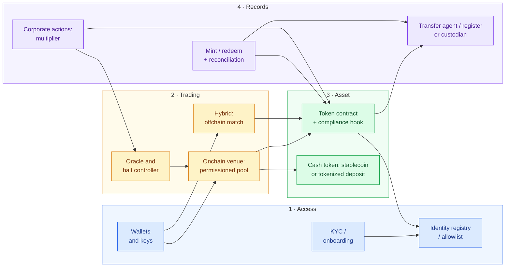
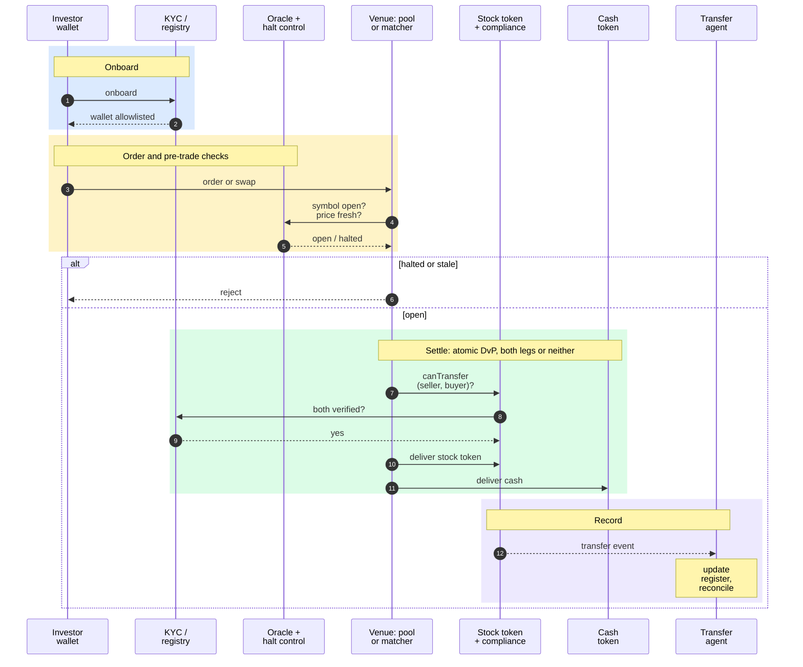

*In plain English: an overview of how a tokenized-stock trading system fits together, from letting an investor in, through the trade, to updating the official record. Deeper pages on each part will be added as the roadmap ships.*

## End-to-end components

Terms: [[concepts/glossary#kyc|KYC]] · [[concepts/glossary#allowlist|allowlist]] · [[concepts/glossary#wallet|wallets]] · [[concepts/glossary#admin-keys|keys]] · [[concepts/glossary#permissioned-pool|permissioned pool]] · [[concepts/glossary#hybrid-matching|hybrid matching]] · [[concepts/glossary#onchain--offchain|offchain]] · [[concepts/glossary#oracle|oracle]] · [[concepts/glossary#halt|halt]] · [[concepts/glossary#compliance-hook|compliance hook]] · [[concepts/glossary#stablecoin|stablecoin]] · [[concepts/glossary#tokenized-deposit|tokenized deposit]] · [[concepts/glossary#mint|mint]] · [[concepts/glossary#redeem|redeem]] · [[concepts/glossary#reconciliation|reconciliation]] · [[concepts/glossary#transfer-agent|transfer agent]] · [[concepts/glossary#custodian|custodian]] · [[concepts/glossary#corporate-action|corporate actions]] · [[concepts/glossary#multiplier|multiplier]]

Colors: **blue** = access, **amber** = trading, **green** = asset and cash, **purple** = records.

## One trade, end to end

Terms: [[concepts/glossary#dvp|DvP]] · [[concepts/glossary#atomic-settlement|atomic settlement]] · [[concepts/glossary#oracle|oracle]] · [[concepts/glossary#halt|halted]] · [[concepts/glossary#compliance-hook|compliance]] · [[concepts/glossary#transfer-agent|transfer agent]] · [[concepts/glossary#reconciliation|reconcile]]

Phases: **blue** = onboard, **amber** = order and checks, **green** = atomic settlement, **purple** = record. Same colors as the component map above.

## Components
| Component | What it does |
|---|---|
| Token contract + [[concepts/glossary#compliance-hook|compliance hook]] | Only eligible wallets can hold or receive |
| [[concepts/glossary#mint|Mint]] / [[concepts/glossary#redeem|redeem]] + [[concepts/glossary#reconciliation|reconciliation]] | Supply matches real shares |
| Venue ([[concepts/glossary#permissioned-pool|permissioned pool]] or [[concepts/glossary#hybrid-matching|hybrid]]) | Matches and settles trades |
| [[concepts/glossary#oracle|Oracle]] + [[concepts/glossary#halt|halt]] control | Fresh prices; stop when the stock is halted |
| [[concepts/glossary#transfer-agent|Transfer agent]] / register | The official record stays in sync with the chain |

## Key rules
1. Only allowlisted wallets ever receive the stock token ([ERC-3643](https://eips.ethereum.org/EIPS/eip-3643)).
2. Both legs of a trade settle or neither does ([[concepts/glossary#atomic-settlement|atomic settlement]]).
3. No trading while the primary exchange has the stock halted ([SEC order](https://www.sec.gov/files/rules/exorders/2026/34-106402.pdf)).

> [!note] vs traditional trading infrastructure
> Traditional trading uses broker order routing, exchange order books or RFQ, CCP netting and T+1 settlement at DTC, with eligibility enforced by brokers and the transfer agent. Tokenized rails move eligibility into the token, settle atomically and run 24/7. See [[topics/settlement-and-matching|Settlement & matching]] and [[concepts/post-trade-reg-nms-model|Post-trade (Reg NMS) model]].

## Sources
Public originals for the facts on this page.

- <https://www.sec.gov/files/rules/exorders/2026/34-106402.pdf>
- <https://developers.uniswap.org/docs/protocols/v4-hooks/permissioned-pools/architecture>
- <https://www.tokenizedstockvenue.com/notice.html>
- <https://eips.ethereum.org/EIPS/eip-3643>
- <https://www.bis.org/publ/arpdf/ar2025e3.htm>
- <https://dtcclearning.com/documents/dtcc-digital-assets/digital-asset-solutions/tokenization-service/5699-dtcc-tokenization-service-product-tear-sheet-and-high-level-roadmap/file.html>
- <https://docs.chain.link/data-feeds/tokenized-equity-feeds>
- <https://www.sec.gov/files/rules/sro/nasdaq/2026/34-105047.pdf>
