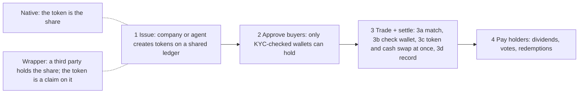

<picture>
<source media="(max-width: 700px)" srcset="/diagrams/overview-mobile.svg">

</picture>

*Terms in this diagram: [[concepts/glossary#native-token|native token]], [[concepts/glossary#wrapper|wrapper]], [[concepts/glossary#kyc|KYC]], [[concepts/glossary#atomic-settlement|atomic]], [[concepts/glossary#t1|T+1]], [[concepts/glossary#custodian|custodian]]. [See the detailed version](#the-full-picture)*

## Why tokenize securities?
Today, buying a stock or bond goes through a chain of brokers, [[concepts/glossary#custodian|custodians]] and [[concepts/glossary#ccp|clearinghouses]]. Each one keeps its own records and has to reconcile them with the others, which is why settlement takes days and markets close at night. A token puts the asset and its ownership record on one shared ledger, so:

- **Cash and asset swap in one step.** Both sides settle together or not at all ([ECB](https://www.ecb.europa.eu/press/key/date/2026/html/ecb.sp260826~3641116314.en.html)).
- **Markets don't need to close.** Trades could clear in seconds, 24/7 ([BlackRock](https://www.blackrock.com/corporate/investor-relations/2025-larry-fink-annual-chairmans-letter)).
- **Assets plug into other things.** Tokenized Treasuries can already be posted as collateral for futures and swaps ([CFTC](https://www.cftc.gov/PressRoom/PressReleases/9146-25)).
- **More people get access.** You can own fractions, from anywhere.

It's already real for big institutions, though two common numbers measure different things. About \$368B of repo trades *settle every day* on Broadridge's blockchain platform: that is a daily flow, with the same cash and bonds lent and repaid over and over ([Broadridge](https://www.broadridge.com/press-release/2025/broadridge-distributed-ledger-repo-platform-november)).

Tokenized Treasuries *held* on blockchains total about \$14.5B as of Oct 2026: that is a stock of assets, like an account balance ([rwa.xyz](https://app.rwa.xyz/treasuries)). Most tokenized assets so far are bonds and [[concepts/glossary#money-market-fund|money market funds]] ([IOSCO](https://www.iosco.org/library/pubdocs/pdf/IOSCOPD809.pdf)).

Many stock tokens are wrappers: a third party holds the real share and gives you a token that tracks it, usually without a vote ([[overview#native-vs-wrapped|native vs wrapper]]).

## Who is this for?
- **Investors** curious about stock tokens: what you actually own, who can buy, the risks. Start with the [[overview|overview]] and the [[concepts/glossary|glossary]].
- **Capital-markets people:** how issuance, trading, settlement and custody map to the rails you know. Start with [[overview#the-full-picture|the full-picture diagram]] and the topic pages: [[topics/settlement-and-matching|Settlement & matching]], [[topics/custody|Custody]], [[topics/regulation|Regulation]].
- **Crypto people:** the securities rules, issuers and venues behind tokenized stocks. Start with [[topics/rules-by-jurisdiction|Rules by jurisdiction]] and the [database](/database).
- **Software engineers and architects:** how tokenized securities systems are built: token contracts and compliance hooks, mint/redeem, onchain venues, atomic settlement, onchain corporate actions, with the standards and trade-offs behind each. Use it with your AI coding agents as a design reference for building or improving these systems, especially trading. Start with the [[build/trading-reference-architecture|reference architecture for trading]] and [[build/index|Build with this wiki]].
- **AI agents:** machine-readable via [llms.txt](/llms.txt) and the [agents guide](/agents), with sources on every fact, weekly updates and stable page anchors.

What it isn't: a broker or investment advice. It's reference information, updated weekly.

## How to use this wiki
- **New to this?** Read the "Why" above, then the diagram at the top, then [[topics/who-can-buy|Who can buy]].
- **Stuck on a word?** Look it up in the [[concepts/glossary|glossary]].
- **Comparing platforms?** Use the [database](/database) of issuers and venues.
- **Using an AI assistant?** Start with the [starter prompts](/starter-prompts) or the [guide for agents](/agents).
- **Following rule changes?** See [what changed this week](/whats-changed), the [changelog](/changelog/), or [subscribe](/subscribe) for updates.
- **Which rules apply where?** See [[topics/rules-by-jurisdiction|Rules by jurisdiction]].

## The one-sentence version
A tokenized security is an ordinary stock or bond whose ownership record lives on a shared digital ledger, so trading, settling and paying dividends can run automatically.

## What's actually different from today's rails
- **One shared record instead of many copies.** Today the official list of who owns a share sits with a [[concepts/glossary#transfer-agent|transfer agent]] or central depository, and every bank and broker in between keeps its own copy that has to be checked against the others. With tokens, everyone works from the same ledger, and the token balance can be the official record. The BIS says this joins "messaging, reconciliation and asset transfer into a single, seamless operation" ([BIS AER 2025, ch. III](https://www.bis.org/publ/arpdf/ar2025e3.htm)). A transfer agent often stays involved for regulatory reasons ([IOSCO](https://www.iosco.org/library/pubdocs/pdf/IOSCOPD809.pdf)).
- **Cash and asset swap at the same moment.** If the payment is also a token on the same ledger, one transaction can move the security one way and the cash the other: both happen or neither does. This is called [[concepts/glossary#atomic-settlement|atomic]] [[concepts/glossary#dvp|delivery versus payment]] (DvP) ([BIS](https://www.bis.org/publ/arpdf/ar2025e3.htm)). The digital cash can be central bank money, tokenized bank deposits or [[concepts/glossary#stablecoin|stablecoins]] ([WEF 2025](https://www.weforum.org/publications/asset-tokenization-in-financial-markets-the-next-generation-of-value-exchange/)), and which one is used changes the risk ([FSB 2024](https://www.fsb.org/uploads/P221024-2.pdf)). More: [[topics/settlement-and-matching|Settlement & matching]].
- **The rules travel with the token.** Securities law still applies, so the token itself can refuse a transfer to a [[concepts/glossary#wallet|wallet]] that has not passed identity checks, and the issuer can freeze or recover tokens. ERC-3643 is one standard that works this way ([EIP-3643](https://eips.ethereum.org/EIPS/eip-3643)). See [[standards/erc-3643|ERC-3643]], [[standards/erc-1400|ERC-1400]], [[standards/solana-token-2022|Token-2022]].
- **Always open, and reusable.** The ledger never closes, and the same token can be plugged into other uses such as collateral or lending ([IOSCO](https://www.iosco.org/library/pubdocs/pdf/IOSCOPD809.pdf)). The flip side is that tightly linked systems can pass problems along; WEF flags the risk of "limitless composability" ([WEF](https://www.weforum.org/publications/asset-tokenization-in-financial-markets-the-next-generation-of-value-exchange/)).

## Native vs wrapped
There are two ways to put a share on a ledger, and which one you hold decides what you actually own.
- **Native: the token is the share.** The company, or its transfer agent, issues the security on the ledger, and your token balance is the official ownership record ([IOSCO](https://www.iosco.org/library/pubdocs/pdf/IOSCOPD809.pdf); [SEC staff, 28 Jan 2026](https://www.sec.gov/newsroom/speeches-statements/corp-fin-statement-tokenized-securities-012826-statement-tokenized-securities)). Examples: [[issuers/superstate-opening-bell|Superstate Opening Bell]], [[issuers/securitize|Securitize]] transfer-agent issuances.
- **Wrapper: a claim on a share.** The real share stays with a custodian or broker in the traditional system, and a third party issues a token that tracks it. SEC staff split wrappers into custodial ones (a claim on the held share) and [[concepts/glossary#synthetic-wrapper|synthetic]] ones (a separate contract, such as a note or swap) ([SEC staff](https://www.sec.gov/newsroom/speeches-statements/corp-fin-statement-tokenized-securities-012826-statement-tokenized-securities)). Someone has to keep the number of tokens matched to the shares held, and you can only swap back through the issuer ([WEF](https://www.weforum.org/publications/asset-tokenization-in-financial-markets-the-next-generation-of-value-exchange/)).

> **Downsides of holding a wrapper.**
> - You own a claim on a firm that holds the share, not the share itself.
> - Usually no voting rights ([SEC staff](https://www.sec.gov/newsroom/speeches-statements/corp-fin-statement-tokenized-securities-012826-statement-tokenized-securities)).
> - You rely on that firm to keep the share safe and to [[concepts/glossary#redeem|redeem]] it ([WEF](https://www.weforum.org/publications/asset-tokenization-in-financial-markets-the-next-generation-of-value-exchange/)). If it fails, you can lose money even if the company behind the share is fine: Robinhood warns its EU stock-token buyers they could lose up to their full investment if Robinhood becomes insolvent ([Robinhood EU](https://robinhood.com/eu/en/support/articles/stock-tokens-faq/)).
> - The token can trade at a different price from the share.
> - The company behind the share may not have agreed: 22 companies had objected to tokens of their shares on OKXICE by 23 Oct 2026 ([[platforms-venues/okxice-tsv#issuer-objections|OKXICE objections]]).

The legal wrapper decides what the holder actually owns. More: [[concepts/legal-taxonomy|Legal taxonomy]], [[topics/legal-structures|Legal structures]] and [[comparisons/implementations-by-model|implementations by model]].

## The full picture
The same four steps in detail: who does what at each step, the traditional role each part replaces, and how native and wrapped tokens differ.

<picture>
<source media="(max-width: 700px)" srcset="/diagrams/overview-detailed-mobile.svg">

</picture>

*Terms in this diagram: [[concepts/glossary#transfer-agent|transfer agent]], [[concepts/glossary#allowlist|allowlist]], [[concepts/glossary#kyc|KYC]], [[concepts/glossary#ats|ATS]], [[concepts/glossary#rfq|RFQ]], [[concepts/glossary#amm-automated-market-maker|onchain pool (AMM)]], [[concepts/glossary#smart-contract|smart contract]], [[concepts/glossary#prefunding|pre-funded]], [[concepts/glossary#netting|netting]], [[concepts/glossary#atomic-settlement|atomic]], [[concepts/glossary#dvp|DvP]], [[concepts/glossary#stablecoin|stablecoin]], [[concepts/glossary#tokenized-deposit|tokenized deposit]], [[concepts/glossary#t1|T+1]], [[concepts/glossary#ccp|CCP]], [[concepts/glossary#csd|CSD]], [[concepts/glossary#composability|composable]], [[concepts/glossary#custodian|custodian]], [[concepts/glossary#native-token|native]], [[concepts/glossary#wrapper|wrapped]].*

## The four steps in the diagram
1. **Issue.** The issuer, or its transfer agent, creates tokens and keeps them in sync with the official register. For wrappers, a custodian holds the underlying shares.
2. **Approve buyers.** Investors are checked once ([[concepts/glossary#kyc|KYC]]) and their wallets are added to an [[concepts/glossary#allowlist|allowlist]], and every transfer checks the list. This replaces part of what opening an account does today. See [[topics/who-can-buy|Who can buy]].
3. **Trade + settle.** This is where tokenized rails differ most from today's, so it is broken into four parts below.
4. **Pay holders.** Dividends, splits, votes and redemptions run through the token contract or the issuer's agent. See [[topics/corporate-actions-and-dividends|Corporate actions & dividends]] and [[concepts/token-primitives|Token primitives]].

## Inside step 3: trade and settle
- **3a Match.** Orders still meet on a familiar venue, such as an exchange or [[concepts/glossary#ats|ATS]] order book or a broker's [[concepts/glossary#rfq|RFQ]], or in an [[concepts/glossary#amm-automated-market-maker|onchain pool]] or AMM, as in [[infrastructure/uniswap-permissioned-pools|permissioned pools]] and the [[concepts/innovation-exemption|onchain-venue (TSV) model]]. Matching can happen off-chain with only settlement on the ledger, or entirely on-chain. Several US models keep the traditional book and tokenize post-trade only: see the [[concepts/post-trade-reg-nms-model|post-trade / Reg NMS model]] and the [[infrastructure/dtcc-tokenization-pilot|DTC tokenization pilot]].
- **3b Check (pre-trade).** The token contract checks that the receiving wallet is eligible ([EIP-3643](https://eips.ethereum.org/EIPS/eip-3643)). Because on-ledger settlement is usually trade by trade (gross), both legs typically have to be in place up front. Projects that "eliminate principal counterparty risk" do so by requiring "high levels of liquidity, often through [[concepts/glossary#prefunding|prefunding]] on a platform" ([FSB 2024](https://www.fsb.org/uploads/P221024-2.pdf)), rather than the [[concepts/glossary#netting|netting]] and credit that today's CCPs and brokers provide.
- **3c Settle.** A [[concepts/glossary#smart-contract|smart contract]] swaps the security token for the cash token in one transaction, so both legs settle or neither does ([BIS](https://www.bis.org/publ/arpdf/ar2025e3.htm)). IOSCO describes a range of settlement models. At one end the ledger is only shared books and records, and [[concepts/glossary#settlement-finality|settlement finality]] "remain[s] with the [[concepts/glossary#csd|CSD]]". At the other is DLT-native settlement, with assets and settlement instruments on the same ledger or linked ones ([IOSCO](https://www.iosco.org/library/pubdocs/pdf/IOSCOPD809.pdf)). Finality is still a legal question, not just a technical one: final settlement "is a legally defined moment" ([FSB](https://www.fsb.org/uploads/P221024-2.pdf)).
- **3d Record (post-trade).** Wallet balances update at once. For [[concepts/glossary#native-token|native tokens]] that is the register update. For wrapped tokens, or where a transfer agent keeps the official register, the books must still be updated or reconciled against the ledger ([WEF](https://www.weforum.org/publications/asset-tokenization-in-financial-markets-the-next-generation-of-value-exchange/); [IOSCO](https://www.iosco.org/library/pubdocs/pdf/IOSCOPD809.pdf)). Regulatory reporting still applies.

**Trade-offs.**
- **Pre-funding.** It removes settlement exposure but costs liquidity. The FSB warns that higher prefunding needs at scale could weaken resilience to liquidity shocks ([FSB](https://www.fsb.org/uploads/P221024-2.pdf)). IOSCO notes that CCP functions such as netting could in time be encoded in smart contracts ([IOSCO](https://www.iosco.org/library/pubdocs/pdf/IOSCOPD809.pdf)).
- **Market hours.** An always-on ledger does not make 24/7 trading automatic. WEF calls always-on infrastructure "a design choice dependent on market demand, risk tolerance and technology" ([WEF](https://www.weforum.org/publications/asset-tokenization-in-financial-markets-the-next-generation-of-value-exchange/)).
- **Cash leg.** The choice of cash token matters. The CPMI-IOSCO principles favour central bank money where practical and available, as cited by [WEF](https://www.weforum.org/publications/asset-tokenization-in-financial-markets-the-next-generation-of-value-exchange/).

## Mapping to familiar roles
| TradFi role | Tokenized equivalent |
|---|---|
| Registrar / transfer agent / CSD | Token contract (native) or custodian plus token (wrapped); transfer agent often remains ([IOSCO](https://www.iosco.org/library/pubdocs/pdf/IOSCOPD809.pdf)) |
| Account opening / KYC | Identity registry and allowlist ([EIP-3643](https://eips.ethereum.org/EIPS/eip-3643)) |
| Exchange / ATS / broker | Same roles, or an onchain venue |
| CCP netting + T+1 settlement via CSD | Pre-funded, trade-by-trade atomic DvP on the ledger ([FSB](https://www.fsb.org/uploads/P221024-2.pdf)) |
| Cash in bank or central bank accounts | Tokenized deposits, wholesale CBDC or stablecoins ([WEF](https://www.weforum.org/publications/asset-tokenization-in-financial-markets-the-next-generation-of-value-exchange/)) |
| Brokerage account | Custodial or self-held wallet ([[topics/custody|Custody]]) |

## Formal definitions
CPMI: "the process of generating and recording a digital representation of traditional assets on a programmable platform" ([CPMI 2024](https://www.bis.org/cpmi/publ/d225.htm)). IOSCO: the "creation, issuance, or representation of assets on a digital token ledger or a programmable platform" ([IOSCO 2025](https://www.iosco.org/library/pubdocs/pdf/IOSCOPD809.pdf)).

## Where it stands
Adoption is real but early. IOSCO finds it "incipient and incremental," led by fixed income and money market funds (see the [[comparisons/buidl-precedent|BUIDL precedent]]). A lack of cross-chain interoperability and of credible settlement assets limits scale, and many participants still use traditional trading and post-trade infrastructure ([IOSCO](https://www.iosco.org/library/pubdocs/pdf/IOSCOPD809.pdf)).

The FSB sees no material stability risk at today's small scale. It names liquidity and maturity mismatch, leverage, asset quality, interconnectedness and operational fragility as the vulnerabilities to watch ([FSB](https://www.fsb.org/uploads/P221024-2.pdf)). The BIS argues for a "unified ledger" with tokenised central bank reserves, commercial bank money and government bonds at its centre ([BIS](https://www.bis.org/publ/arpdf/ar2025e3.htm)).

Regulators broadly apply "same activities, same risks, same regulatory outcomes" ([IOSCO](https://www.iosco.org/library/pubdocs/pdf/IOSCOPD809.pdf)). For the US and EU specifics, see [[topics/regulation|Regulation]] and [[concepts/international|International]].

## Text version of the diagram

*Reference information only. Not investment advice.*

## Sources
Public originals for the facts on this page.

- <https://www.iosco.org/library/pubdocs/pdf/IOSCOPD809.pdf>
- <https://www.fsb.org/uploads/P221024-2.pdf>
- <https://www.bis.org/publ/arpdf/ar2025e3.htm>
- <https://www.bis.org/cpmi/publ/d225.htm>
- <https://www.weforum.org/publications/asset-tokenization-in-financial-markets-the-next-generation-of-value-exchange/>
- <https://www.sec.gov/newsroom/speeches-statements/corp-fin-statement-tokenized-securities-012826-statement-tokenized-securities>
- <https://eips.ethereum.org/EIPS/eip-3643>
- <https://www.ecb.europa.eu/press/key/date/2026/html/ecb.sp260826~3641116314.en.html>
- <https://www.blackrock.com/corporate/investor-relations/2025-larry-fink-annual-chairmans-letter>
- <https://www.broadridge.com/press-release/2025/broadridge-distributed-ledger-repo-platform-november>
- <https://www.cftc.gov/PressRoom/PressReleases/9146-25>
- <https://app.rwa.xyz/treasuries>
- <https://www.mckinsey.com/industries/financial-services/our-insights/from-ripples-to-waves-the-transformational-power-of-tokenizing-assets>
- <https://www.sec.gov/newsroom/speeches-statements/atkins-111225-secs-approach-digital-assets-inside-project-crypto>
- <https://www.mas.gov.sg/news/speeches/2024/tokenisation-in-financial-services-pathways-to-scale>
- <https://robinhood.com/eu/en/support/articles/stock-tokens-faq/>
