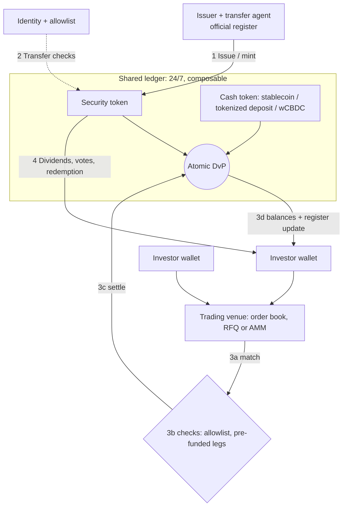

<picture>
<source media="(max-width: 700px)" srcset="/diagrams/overview-mobile.svg">

</picture>

## Why tokenize securities?
Today, buying a stock or bond goes through a chain of brokers, custodians and clearinghouses. Each one keeps its own records and has to reconcile them with the others, which is why settlement takes days and markets close at night. A token puts the asset and its ownership record on one shared ledger, so:

- **Cash and asset swap in one step.** Both sides settle together or not at all ([ECB](https://www.ecb.europa.eu/press/key/date/2026/html/ecb.sp260826~3641116314.en.html)).
- **Markets don't need to close.** Trades could clear in seconds, 24/7 ([BlackRock](https://www.blackrock.com/corporate/investor-relations/2025-larry-fink-annual-chairmans-letter)).
- **Assets plug into other things.** Tokenized Treasuries can already be posted as collateral for futures and swaps ([CFTC](https://www.cftc.gov/PressRoom/PressReleases/9146-25)).
- **More people get access.** You can own fractions, from anywhere.

It's already real for big institutions: about \$368B a day of repo trades settle on Broadridge's blockchain platform ([Broadridge](https://www.broadridge.com/press-release/2025/broadridge-distributed-ledger-repo-platform-november)). What's been turned into tokens so far is mostly bonds and money market funds; tokenized Treasuries total about \$14.5B as of Oct 2026 ([rwa.xyz](https://app.rwa.xyz/treasuries)). Many stock tokens are wrappers rather than real shares, so check what you actually own.

*For readers who know capital markets (and maybe crypto at a high level) but not how the pieces connect. This page covers what is new compared with traditional rails; the linked pages go deeper.*

## How to use this wiki
- **New to this?** Read the "Why" above, then the diagram at the top, then [[topics/who-can-buy|Who can buy]].
- **Comparing platforms?** Use the [database](/database) of issuers and venues.
- **Using an AI assistant?** Start with the [starter prompts](/starter-prompts) or the [guide for agents](/agents).
- **Following rule changes?** Check the [changelog](/changelog/) or [subscribe](/subscribe) for updates.

## The one-sentence version
A tokenized security is an ordinary stock or bond whose ownership record lives on a shared digital ledger, so trading, settling and paying dividends can run automatically.

> **Formal definitions.** CPMI: "the process of generating and recording a digital representation of traditional assets on a programmable platform" ([CPMI 2024](https://www.bis.org/cpmi/publ/d225.htm)). IOSCO: the "creation, issuance, or representation of assets on a digital token ledger or a programmable platform" ([IOSCO 2025](https://www.iosco.org/library/pubdocs/pdf/IOSCOPD809.pdf)).

## What's actually different from today's rails
- **The token is the record, or mirrors it.** Today the issuer's register sits with a transfer agent or CSD, and every intermediary keeps its own books that must be reconciled. On a shared ledger the token balance can be the register entry itself. The BIS says tokenisation "enables the integration of messaging, reconciliation and asset transfer into a single, seamless operation" ([BIS AER 2025, ch. III](https://www.bis.org/publ/arpdf/ar2025e3.htm)). IOSCO notes that a registrar is not technically required, but a transfer agent often stays for regulatory reasons ([IOSCO](https://www.iosco.org/library/pubdocs/pdf/IOSCOPD809.pdf)).
- **Atomic DvP with a tokenized cash leg.** If the cash is also a token on the same platform, the security and the payment can move in one transaction, so both legs settle or neither does. The BIS calls DvP "the canonical example of the contingent performance of actions" ([BIS](https://www.bis.org/publ/arpdf/ar2025e3.htm)). The cash token can be central bank money, tokenized deposits or fiat-backed stablecoins ([WEF 2025](https://www.weforum.org/publications/asset-tokenization-in-financial-markets-the-next-generation-of-value-exchange/)). Settlement-asset choice drives the risk profile ([FSB 2024](https://www.fsb.org/uploads/P221024-2.pdf)). More: [[topics/settlement-and-matching|Settlement & matching]].
- **Permissioned transfer.** Securities law still applies, so tokens usually check eligibility on every transfer. ERC-3643, for example, lets a transfer succeed only between verified identities that pass compliance rules, and supports freeze and forced transfer for recovery ([EIP-3643](https://eips.ethereum.org/EIPS/eip-3643)). See [[standards/erc-3643|ERC-3643]], [[standards/erc-1400|ERC-1400]], [[standards/solana-token-2022|Token-2022]].
- **24/7 and composable.** A shared ledger never closes, and tokens can be reused across applications such as collateral, lending and pools. IOSCO lists fractionalization, programmability, composability and atomicity as the features tokenization arrangements seek ([IOSCO](https://www.iosco.org/library/pubdocs/pdf/IOSCOPD809.pdf)). WEF flags a matching risk of "limitless composability" ([WEF](https://www.weforum.org/publications/asset-tokenization-in-financial-markets-the-next-generation-of-value-exchange/)).

## Native vs wrapped
- **Native (digital native, issuer-sponsored).** The security is issued on the ledger, and the token is the ownership record ([IOSCO](https://www.iosco.org/library/pubdocs/pdf/IOSCOPD809.pdf); [FSB](https://www.fsb.org/uploads/P221024-2.pdf)). In SEC staff terms, the issuer or its agent integrates the ledger into the securityholder records ([SEC staff, 28 Jan 2026](https://www.sec.gov/newsroom/speeches-statements/corp-fin-statement-tokenized-securities-012826-statement-tokenized-securities)). Examples: [[issuers/superstate-opening-bell|Superstate Opening Bell]], [[issuers/securitize|Securitize]] transfer-agent issuances.
- **Wrapped / backed (digital twin, third-party).** The underlying security stays in traditional custody and the token is a claim on it. The SEC staff split this into custodial (security entitlement) and synthetic (a separate note or swap) models ([SEC staff](https://www.sec.gov/newsroom/speeches-statements/corp-fin-statement-tokenized-securities-012826-statement-tokenized-securities)). Backed models need audits and reconciliation of tokens against the reference asset, and depend on bankruptcy-remote custody and the issuer's redemption operations ([WEF](https://www.weforum.org/publications/asset-tokenization-in-financial-markets-the-next-generation-of-value-exchange/)).

> **Downsides of wrapped tokens.**
> - You own a claim on a company that holds the share, not the share itself.
> - Usually no voting rights.
> - You depend on that company's custody and its ability to redeem.
> - The token can trade away from the share price.
> - The company behind the share may not have agreed: 16 companies have objected to tokens of their shares on OKXICE ([[platforms-venues/okxice-tsv#issuer-objections|OKXICE objections]]).

The legal wrapper decides what the holder actually owns. More: [[concepts/legal-taxonomy|Legal taxonomy]], [[topics/legal-structures|Legal structures]] and [[comparisons/implementations-by-model|implementations by model]].

## The four flows in the diagram
1. **Issue.** The issuer, or its transfer agent, mints tokens and keeps them in sync with the official register. For wrapped tokens, the custodian holds the underlying shares.
2. **Permission.** Investors are onboarded once (KYC) and their wallets are allowlisted, and every transfer checks the list. This replaces part of what account opening does today. See [[topics/who-can-buy|Who can buy]].
3. **Trade + settle.** This is where tokenized rails differ most from today's, so it is broken into four parts below.
4. **Service.** Dividends, splits, votes and redemptions run through the token contract or the issuer's agent. See [[topics/corporate-actions-and-dividends|Corporate actions & dividends]] and [[concepts/token-primitives|Token primitives]].

## Inside step 3: trade and settle
- **3a Match.** Orders still meet on a familiar venue, such as an exchange or ATS order book or a broker's RFQ, or in an onchain pool or AMM, as in [[infrastructure/uniswap-permissioned-pools|permissioned pools]] and the [[concepts/innovation-exemption|onchain-venue (TSV) model]]. Matching can happen off-chain with only settlement on the ledger, or entirely on-chain. Several US models keep the traditional book and tokenize post-trade only: see the [[concepts/post-trade-reg-nms-model|post-trade / Reg NMS model]] and the [[infrastructure/dtcc-tokenization-pilot|DTC tokenization pilot]].
- **3b Pre-trade checks.** The token contract checks that the receiving wallet is eligible ([EIP-3643](https://eips.ethereum.org/EIPS/eip-3643)). Because on-ledger settlement is usually trade by trade (gross), both legs typically have to be in place up front. Projects that "eliminate principal counterparty risk" do so by requiring "high levels of liquidity, often through prefunding on a platform" ([FSB 2024](https://www.fsb.org/uploads/P221024-2.pdf)), rather than the netting and credit that today's CCPs and brokers provide.
- **3c Settle.** A smart contract swaps the security token for the cash token in one transaction, so both legs settle or neither does ([BIS](https://www.bis.org/publ/arpdf/ar2025e3.htm)). IOSCO describes a range of settlement models. At one end the ledger is only shared books and records, and settlement finality "remain[s] with the CSD". At the other is DLT-native settlement, with assets and settlement instruments on the same ledger or linked ones ([IOSCO](https://www.iosco.org/library/pubdocs/pdf/IOSCOPD809.pdf)). Finality is still a legal question, not just a technical one: final settlement "is a legally defined moment" ([FSB](https://www.fsb.org/uploads/P221024-2.pdf)).
- **3d Post-trade.** Wallet balances update at once. For native tokens that is the register update. For wrapped tokens, or where a transfer agent keeps the official register, the books must still be updated or reconciled against the ledger ([WEF](https://www.weforum.org/publications/asset-tokenization-in-financial-markets-the-next-generation-of-value-exchange/); [IOSCO](https://www.iosco.org/library/pubdocs/pdf/IOSCOPD809.pdf)). Regulatory reporting still applies.

**Trade-offs.**
- **Pre-funding.** It removes settlement exposure but costs liquidity. The FSB warns that higher prefunding needs at scale could weaken resilience to liquidity shocks ([FSB](https://www.fsb.org/uploads/P221024-2.pdf)). IOSCO notes that CCP functions such as netting could in time be encoded in smart contracts ([IOSCO](https://www.iosco.org/library/pubdocs/pdf/IOSCOPD809.pdf)).
- **Market hours.** An always-on ledger does not make 24/7 trading automatic. WEF calls always-on infrastructure "a design choice dependent on market demand, risk tolerance and technology" ([WEF](https://www.weforum.org/publications/asset-tokenization-in-financial-markets-the-next-generation-of-value-exchange/)).
- **Cash leg.** The choice of cash token matters. The CPMI-IOSCO principles favour central bank money where practical and available, as cited by [WEF](https://www.weforum.org/publications/asset-tokenization-in-financial-markets-the-next-generation-of-value-exchange/).

## Mapping to familiar roles
| TradFi role | Tokenized equivalent |
|---|---|
| Registrar / transfer agent / CSD | Token contract (native) or custodian plus token (wrapped); transfer agent often remains ([IOSCO](https://www.iosco.org/library/pubdocs/pdf/IOSCOPD809.pdf)) |
| Account opening / KYC | Identity registry and allowlist ([EIP-3643](https://eips.ethereum.org/EIPS/eip-3643)) |
| Exchange / ATS / broker | Same roles, or an onchain venue |
| CCP netting + T+1 settlement via CSD | Pre-funded, trade-by-trade atomic DvP on the ledger ([FSB](https://www.fsb.org/uploads/P221024-2.pdf)) |
| Cash in bank or central bank accounts | Tokenized deposits, wholesale CBDC or stablecoins ([WEF](https://www.weforum.org/publications/asset-tokenization-in-financial-markets-the-next-generation-of-value-exchange/)) |
| Brokerage account | Custodial or self-held wallet ([[topics/custody|Custody]]) |

## Where it stands
Adoption is real but early. IOSCO finds it "incipient and incremental," led by fixed income and money market funds (see the [[comparisons/buidl-precedent|BUIDL precedent]]). A lack of cross-chain interoperability and of credible settlement assets limits scale, and many participants still use traditional trading and post-trade infrastructure ([IOSCO](https://www.iosco.org/library/pubdocs/pdf/IOSCOPD809.pdf)). The FSB sees no material stability risk at today's small scale. It names liquidity and maturity mismatch, leverage, asset quality, interconnectedness and operational fragility as the vulnerabilities to watch ([FSB](https://www.fsb.org/uploads/P221024-2.pdf)). The BIS argues for a "unified ledger" with tokenised central bank reserves, commercial bank money and government bonds at its centre ([BIS](https://www.bis.org/publ/arpdf/ar2025e3.htm)). Regulators broadly apply "same activities, same risks, same regulatory outcomes" ([IOSCO](https://www.iosco.org/library/pubdocs/pdf/IOSCOPD809.pdf)). For the US and EU specifics, see [[topics/regulation|Regulation]] and [[concepts/international|International]].

## Text version of the diagram

*Reference information only. Not investment advice.*

## Sources
Public originals for the facts on this page.

- <https://www.iosco.org/library/pubdocs/pdf/IOSCOPD809.pdf>
- <https://www.fsb.org/uploads/P221024-2.pdf>
- <https://www.bis.org/publ/arpdf/ar2025e3.htm>
- <https://www.bis.org/cpmi/publ/d225.htm>
- <https://www.weforum.org/publications/asset-tokenization-in-financial-markets-the-next-generation-of-value-exchange/>
- <https://www.sec.gov/newsroom/speeches-statements/corp-fin-statement-tokenized-securities-012826-statement-tokenized-securities>
- <https://eips.ethereum.org/EIPS/eip-3643>
- <https://www.ecb.europa.eu/press/key/date/2026/html/ecb.sp260826~3641116314.en.html>
- <https://www.blackrock.com/corporate/investor-relations/2025-larry-fink-annual-chairmans-letter>
- <https://www.broadridge.com/press-release/2025/broadridge-distributed-ledger-repo-platform-november>
- <https://www.cftc.gov/PressRoom/PressReleases/9146-25>
- <https://app.rwa.xyz/treasuries>
- <https://www.mckinsey.com/industries/financial-services/our-insights/from-ripples-to-waves-the-transformational-power-of-tokenizing-assets>
- <https://www.sec.gov/newsroom/speeches-statements/atkins-111225-secs-approach-digital-assets-inside-project-crypto>
- <https://www.mas.gov.sg/news/speeches/2024/tokenisation-in-financial-services-pathways-to-scale>
